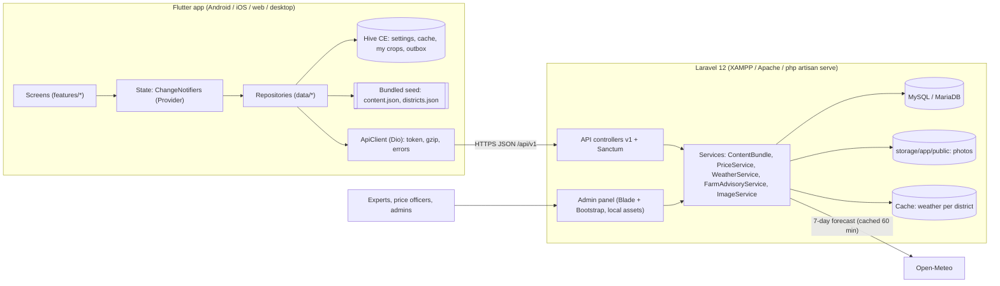
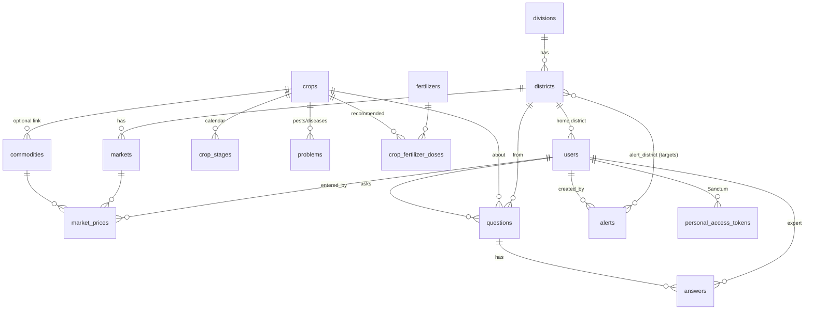

# Krishi Sathi (কৃষি সাথী): Project Plan

*A Bangla-first, offline-first farming companion for Bangladesh*

| | |
|---|---|
| **Status** | MVP built and tested (Flutter app, Laravel API and admin panel, MySQL schema with seed content) |
| **Repository layout** | `backend/` (Laravel 12), `mobile/` (Flutter), `docs/` (API, admin guide, screenshots), `tools/e2e/` (browser walkthrough) |
| **Last updated** | 14 October 2026 |

---

## Table of contents

1. [Project overview, objectives and target users](#1-project-overview-objectives-and-target-users)
2. [Research findings and identified problems](#2-research-findings-and-identified-problems)
3. [Competitor analysis](#3-competitor-analysis)
4. [Proposed solution and feature prioritisation](#4-proposed-solution-and-feature-prioritisation)
5. [Functional and non-functional requirements](#5-functional-and-non-functional-requirements)
6. [System architecture and technology stack](#6-system-architecture-and-technology-stack)
7. [Database design and relationships](#7-database-design-and-relationships)
8. [API design and integration requirements](#8-api-design-and-integration-requirements)
9. [Flutter app structure and Laravel admin-panel structure](#9-flutter-app-structure-and-laravel-admin-panel-structure)
10. [Development phases, milestones and scope of work](#10-development-phases-milestones-and-scope-of-work)
11. [Local installation and configuration (XAMPP)](#11-local-installation-and-configuration-xampp)
12. [Testing, deployment, security and maintenance plans](#12-testing-deployment-security-and-maintenance-plans)
13. [Known limitations, future improvements and roadmap](#13-known-limitations-future-improvements-and-roadmap)
14. [Assumptions and key technical decisions](#14-assumptions-and-key-technical-decisions)
15. [The colleague's Google AI Studio app](#15-the-colleagues-google-ai-studio-app)
16. [Sources](#16-sources)

---

## 1. Project overview, objectives and target users

### 1.1 Overview

**Krishi Sathi** ("farming companion") puts the advice a farmer needs every week into one simple app that works without internet:

* **What is wrong with my crop, and what should I do?** A picture-led crop doctor with integrated pest management (IPM) advice first and chemicals last, plus safety guidance.
* **What should I do this week?** A personal crop calendar built from the sowing or transplanting date.
* **Is the weather going to ruin my work?** A 7-day forecast turned into plain farm advice ("do not spray, heavy rain in 2 days").
* **What price should I expect, and when should I sell?** Nearby market prices with trends and 30-day history.
* **How much fertilizer, and what should it cost?** A calculator in local units (bigha, katha, shotok) with government prices.
* **I'm still not sure.** Ask an agriculture expert with a photo, or call 16123 for free.

Behind the app, a **Laravel admin panel** lets agronomists maintain the knowledge base, answer questions and broadcast alerts. Data-entry staff use it to enter daily market prices.

### 1.2 Objectives

| # | Objective | How we measure it (pilot) |
|---|---|---|
| O1 | Give smallholders reliable, timely advice in Bangla | Over 80% of test users can find the right advice for a given problem within 2 minutes |
| O2 | Reduce unnecessary pesticide use | Advice order is prevention → organic → chemical; track "listened/read IPM section" and survey spraying frequency |
| O3 | Improve selling decisions | Users check prices before selling; survey on price obtained against the board |
| O4 | Turn forecasts into farm actions | Weekly active weather-screen users; advisory recall in surveys |
| O5 | Connect farmers to experts at scale | Median answer time under 24 hours; share of questions published as community answers |
| O6 | Work for last-mile users | Usable offline; under 40 KB to refresh the knowledge base; works on 2 GB RAM Android phones |

### 1.3 Target users

| Persona | Who | Needs | Design response |
|---|---|---|---|
| **Smallholder farmer** (primary) | Grows rice, potato, vegetables on under 1 ha; low or partial literacy; shared family smartphone | Pest and disease help, what to do when, prices, weather | Big icon tiles, Bangla, read-aloud, offline, calendar, prices |
| **Home and rooftop gardener** | Urban (for example Dhaka's roughly 4.5 lakh roofs) or homestead (often women) | What to plant now, container tips, organic pest control | "Gardener" mode reorders home and filters crops to rooftop-friendly ones |
| **Student or enthusiast** | Agriculture students, young people returning to farming | Structured crop knowledge | Crop guides, articles |
| **Extension worker** | SAAO, NGO field staff | Quick reference in the field, show farmers on the phone | Offline knowledge base, Q&A |
| **Agriculture expert** (admin side) | Agronomists, DAE officers | Answer questions, curate content | Expert inbox, content CRUD |
| **Price data-entry officer** (admin side) | Market survey staff | Fast daily entry | Grid entry pre-filled with last prices, CSV import |

---

## 2. Research findings and identified problems

### 2.1 Key facts about the sector

* Agriculture is about **11–12% of GDP** but employs roughly **35–45% of the workforce**, and about two-thirds of rural workers.
* **About 83% of farmers are marginal or small**, operating roughly half of cultivable land. Public spending has not reached them adequately.
* Main constraints reported by experts include rising input costs, **post-harvest losses**, **climate risk**, **limited market access**, a shrinking land base (–0.3% per year), and labour costs that have doubled in a decade.

### 2.2 Problems technology can realistically help with

| # | Problem | Evidence | What the app does about it |
|---|---|---|---|
| P1 | **Advice comes from pesticide sellers, which leads to overuse** | About 78% of farmers used pesticides on dealers' suggestions; over 47% used more than needed; only 4% formally trained. A 2025 Naogaon study found *all* respondents exceeded recommended doses | Crop doctor with IPM-first advice, chemical control last with an explicit safety warning, "no chemical cure" stated where true (saves money), a safe-pesticide-use article |
| P2 | **The extension system cannot reach everyone** | The 16123 call centre handled about **92,000 calls in a year** (2025–26), against more than 16 million farm households | Asynchronous ask-an-expert with photos. Answers can become **public community Q&A**, so one answer serves many farmers |
| P3 | **Price information asymmetry and distress sales** | Dhaka retail vegetable prices are 100–300% above farm gate. Potato sold at Tk 4–7/kg against a Tk 15–17 cost; onion farmers made a 24% loss in FY25. DAM data is published as PDFs | Market price board for the nearest market with trend arrows, 30-day chart, retail vs wholesale, storage guidance |
| P4 | **Forecasts don't reach farmers as actions** | Forecast-based advice gave about 7% higher yield and 13% lower costs. Accurate forecasts cut losses from 4.1% to 0.8%. BAMIS reaches mainly lead farmers by SMS | District forecast with rule-based farm advisories (spray windows, heavy rain, cold wave, late blight, heat, dry spell) and admin alerts for floods and cyclones |
| P5 | **Fertilizer misuse and overcharging** | Recommendations exist (SRDI/BARC) but are technical; 2026 reports of urea at Tk 30–35 against the official Tk 27 | Calculator in local units with the official price and "ask for a receipt" guidance |
| P6 | **Post-harvest losses** | Vegetable losses estimated at 18–44%; onion storage rot | Storage problems in the crop doctor (onion rot), potato and onion storage article, price trends to plan sales |
| P7 | **Low literacy, language and connectivity** | About 26% of rural *individuals* use smartphones, but 69% of rural *households* own one (a shared device). Language and English-term barriers are documented | Bangla-first UI and digits, read-aloud (TTS), icons and emoji, large text option, offline-first, gzip and ETag, data saver |
| P8 | **Home gardeners fail for lack of know-how** | Many rooftop beginners can't sustain gardens; they learn from Facebook | Gardener mode, "what to plant now", container tips per crop, gardening articles |
| P9 | **Fragmented, single-purpose government apps** | Separate apps exist for diagnosis, rice, weather, consumer prices and procurement | One app covering the weekly decision cycle |

### 2.3 Design implications for last-mile users

1. **Bangla by default**, with simple words and local names for pests ("মাজরা পোকা", not "stem borer").
2. **Recognition over reading**: emoji and icons for crops, plant parts and tasks, plus a read-aloud button on all advice.
3. **Offline first**: the knowledge base is bundled with the app and refreshed with a tiny conditional request.
4. **No email, no SMS cost**: phone number + 4–6 digit PIN, familiar from bKash/Nagad. Guests can use everything except asking experts.
5. **Shared phones**: no personal data needed to use the app; "My crops" lives on the phone.
6. **Local units and calendar**: bigha (configurable size), katha, shotok, maund, hali; the Bengali calendar date on home.

---

## 3. Competitor analysis

> The Play Store could not be reached from the build environment, so ratings and review counts were not collected directly. The table summarises published evaluations, news and product descriptions. **Before release, record current Play Store ratings and last-update dates** (see milestone M2).

| App or channel | Owner | What it does | Strengths | Weaknesses and gaps |
|---|---|---|---|---|
| **Krishoker Janala** | DAE / a2i | Picture-based problem diagnosis, over 1,000 problems for 120 crops, offline | Picture-led and offline; government-backed; WSIS award 2016 | Static content and dated UI; no prices, weather, calendar or expert Q&A; no feedback loop |
| **BAMIS app/portal** | BMD + DAE (World Bank) | District agromet advisories, bulletins | Official forecasts and advisories | Technical presentation; reaches mostly lead farmers via SMS; weather only |
| **Rice Doctor / Rice Solution** | IRRI / BRRI | Rice problem diagnosis from photos | Authoritative rice content | Rice only |
| **Plantix** | PEAT GmbH | AI photo diagnosis, about 18 languages including Bangla | Strong AI and a large library | Needs internet and a decent camera; commercial pesticide ties raise promotion concerns; not Bangladesh-specific for prices or weather |
| **iFarmer** | Private | Farm finance, inputs, supply chain via agents | Credit access | Not an advisory app; agent-mediated |
| **WeGro** | Private | Agri-fintech, investment, market data | Financing | Not general advice |
| **Bazardor** | DNCRP (Govt) | District retail prices of essentials | Official, district-level | Consumer-oriented retail prices, no farm advice |
| **Sadai** | DAM (2021) | Government online marketplace for produce | Cuts middlemen in theory | Traction unclear; selling platform, not decision support |
| **Krishoker App** | DG Food | Paddy procurement registration | Official procurement | Very narrow scope |
| **Khamari App** (announced 2025) | MoA | Planned crop management and market info | Government backing | Not yet available in the sources reviewed |
| **Facebook groups / YouTube** (e.g. "Hridoye Mati O Manush") | Community / TV | Peer learning, video | Popular and trusted presenters | Unverified advice; data-heavy video; hard to search |
| **16123 Agriculture Call Centre** | AIS | Free expert phone advice | Human expert, free | About 92k calls per year capacity, no photos, office hours. **The app links to it on every key screen** |

**Positioning.** No product reviewed combines, in Bangla and offline:
IPM-first diagnosis, a personal crop calendar, actionable weather advice, nearby prices, a fertilizer calculator with official prices, and photo-based expert Q&A, serving **both farmers and home gardeners**. Krishi Sathi complements the government channels instead of replacing them: it uses DAE/BARI/BRRI knowledge, promotes 16123, and can import DAM prices and BAMIS advisories (roadmap).

---

## 4. Proposed solution and feature prioritisation

### 4.1 Solution summary

```
Farmer / gardener (Flutter app, Bangla, offline)  ⇄  Laravel REST API  ⇄  MySQL
                                                       ⇅            ⇅
                                        Admin panel (experts, price officers, admins)
                                                       ⇅
                                  Open-Meteo forecast (cached per district; swappable)
```

### 4.2 Prioritisation (impact × feasibility, MoSCoW)

Scores are 1–5. Priority = Impact × Feasibility, adjusted for accessibility.

| Feature | Problem | Impact | Feasibility | Priority | MVP? |
|---|---|---|---|---|---|
| Crop doctor (part-based, IPM-first, offline) | P1, P7 | 5 | 5 | **Must** | ✅ |
| Ask an expert with photo + community Q&A | P1, P2 | 5 | 4 | **Must** | ✅ |
| Market prices (nearest market, trend, history) | P3 | 5 | 4 | **Must** | ✅ |
| Weather + rule-based farm advice + admin alerts | P4 | 5 | 4 | **Must** | ✅ |
| Bangla UI, read-aloud, large text, data saver | P7 | 5 | 4 | **Must** | ✅ |
| Offline knowledge base (bundled, ETag sync) | P7 | 5 | 4 | **Must** | ✅ |
| My crops: personal task calendar | P1, P4 | 4 | 5 | **Should** | ✅ |
| Fertilizer calculator + government prices | P5 | 4 | 5 | **Should** | ✅ |
| What to plant now / gardener mode | P8 | 3 | 5 | **Should** | ✅ |
| Articles (safety, IPM, storage, flood recovery, gardening) | P1, P6, P8 | 3 | 5 | **Should** | ✅ |
| Offline question outbox | P7 | 4 | 4 | **Should** | ✅ |
| Push notifications (alerts, answers, task reminders) | P2, P4 | 4 | 3 | Could | Phase 2 |
| SMS OTP login / PIN reset | security | 3 | 3 | Could | Phase 2 |
| Automated DAM price import / BAMIS advisories | P3, P4 | 4 | 2 | Could | Phase 2 |
| AI photo diagnosis | P1 | 4 | 2 | Could | Phase 3 |
| Voice questions / IVR for feature phones | P7 | 4 | 2 | Could | Phase 3 |
| Marketplace / buyer linkage | P3 | 3 | 2 | Won't (now) | Phase 3 |

Features deliberately **left out** of the MVP: a marketplace (it needs logistics and trust systems; Sadai shows the difficulty), finance (iFarmer and WeGro cover it), social feeds (moderation cost), and AI chat without guardrails (pesticide-advice risk).

---

## 5. Functional and non-functional requirements

### 5.1 Functional requirements (✅ = implemented)

**Mobile app**

| ID | Requirement | |
|---|---|---|
| FR-01 | First-run onboarding: language → user type → district, no typing required | ✅ |
| FR-02 | Home: Bangla and Bengali-calendar date, active alerts, weather summary with top advisory, this week's tasks, feature tiles ordered by user type, 16123 call button | ✅ |
| FR-03 | Crop list with search (Bangla and English), rooftop and category filters | ✅ |
| FR-04 | Crop detail tabs: Problems (filter by plant part), How to grow, Calendar, Fertilizer | ✅ |
| FR-05 | Problem detail: symptoms → prevention/IPM → organic → chemical (with safety warning) → ask expert | ✅ |
| FR-06 | Read any advice aloud in Bangla or English (device TTS) | ✅ |
| FR-07 | Market prices: nearest market by district or a chosen market; wholesale/retail; trend and % change; demo-data warning; tap for 30-day chart | ✅ |
| FR-08 | Weather: current conditions, 7-day forecast, farm advisories, stale/offline indication | ✅ |
| FR-09 | Register or log in with phone + PIN; Bangla digits and +880 accepted | ✅ |
| FR-10 | Ask a question with optional crop and photo (compressed on device); queue offline and send later | ✅ |
| FR-11 | See my questions and answers; browse public community answers | ✅ |
| FR-12 | My crops: add a planting (crop, date, field name); dated task list; tick tasks; this week's tasks on Home | ✅ |
| FR-13 | Fertilizer calculator: crop + land size in shotok/katha/bigha/acre/hectare; kg per fertilizer, when to apply, cost at government price | ✅ |
| FR-14 | What to plant now / harvest now by month, rooftop filter | ✅ |
| FR-15 | Articles list (sorted for the user type) and reader with read-aloud | ✅ |
| FR-16 | Settings: language, district, user type, text size, data saver, bigha size, sync now, account, server address | ✅ |

**API and admin panel**

| ID | Requirement | |
|---|---|---|
| FR-20 | Public read API for content, prices, weather, alerts and community Q&A; authenticated API for profile and questions | ✅ |
| FR-21 | Staff login (email or phone + password); role-based menus and route protection | ✅ |
| FR-22 | Dashboard: pending questions (oldest first), users, prices today, alerts, top crops | ✅ |
| FR-23 | Crop CRUD with photo, months, calendar stages, fertilizer doses | ✅ |
| FR-24 | Problem CRUD with photo and bilingual advice sections; article CRUD | ✅ |
| FR-25 | Expert inbox: filter, view photo and farmer details, answer, publish to community, close spam | ✅ |
| FR-26 | Daily price entry grid (pre-filled hints, single value allowed, update-or-create), CSV import with per-line errors, CSV template, price record list | ✅ |
| FR-27 | Market, commodity and fertilizer-price management | ✅ |
| FR-28 | Alerts: severity, bilingual text, national or selected districts (division shortcut), start/end time | ✅ |
| FR-29 | User and staff management with role rules (no self-demotion; only super admin manages admins); disabling revokes app tokens | ✅ |
| FR-30 | `php artisan krishi:export-content` bundles the knowledge base and districts into the app | ✅ |

### 5.2 Non-functional requirements

| ID | Category | Requirement | How it's met |
|---|---|---|---|
| NFR-01 | Offline | All advice, calendars, calculator and articles work without internet, including on first launch | Bundled `assets/seed/*.json`, Hive cache, cached last responses for prices, weather and questions |
| NFR-02 | Bandwidth | Knowledge-base refresh ≤ 40 KB; unchanged content ≈ 0 KB | Raw UTF-8 JSON + gzip (176 KB → 37 KB); ETag/304; photos ≤ 1280 px JPEG |
| NFR-03 | Performance | Screens open in under 1 s on low-end phones with local data | Local-first rendering, no heavy libraries, custom chart painter |
| NFR-04 | Accessibility | Large touch targets (≥ 48 dp), text scaling up to 1.3× plus the system setting, read-aloud, icons with text, high contrast | Theme and widgets; tiles grow with text (tested) |
| NFR-05 | Localisation | Full Bangla and English UI; Bangla digits; Bengali calendar date; API error messages in the user's language | gen-l10n (255 strings), `Bangla` utils, bilingual DB columns, `Accept-Language` → `lang/bn*` |
| NFR-06 | Security | Hashed PINs and passwords, throttling and lockout, role-based access, validation, upload checks, security headers, token expiry | See §12.3 |
| NFR-07 | Privacy | Community answers never show who asked; minimal personal data; photos re-encoded (removes EXIF/GPS) | `QuestionResource`, `ImageService` |
| NFR-08 | Portability | Android, iOS, web, Windows, macOS, Linux from one codebase; backend runs on XAMPP | Flutter, Laravel 12 on PHP 8.2+ |
| NFR-09 | Maintainability | Layered code, tests, docs, linters | 64 backend + 20 Flutter tests, Pint, flutter_lints, E2E script |
| NFR-10 | Availability | App remains useful if the server or weather provider is down | Stale cache fallback; weather 503 handled; offline outbox |

---

## 6. System architecture and technology stack

### 6.1 Architecture



### 6.2 Technology stack

| Layer | Choice | Why |
|---|---|---|
| Mobile and web client | **Flutter 3.47** (Dart 3.13), Material 3 | One codebase for Android, iOS, web and desktop, as requested |
| State management | `provider` + `ChangeNotifier` | Small, stable and easy to learn; enough for this app |
| HTTP | `dio` | Interceptable, timeouts, multipart uploads on web and mobile |
| Local storage | `hive_ce` (community-maintained Hive) | Works on all platforms including web (IndexedDB); no code generation |
| Other packages | `flutter_tts`, `image_picker`, `cached_network_image`, `url_launcher`, `intl`, gen-l10n | Read-aloud, photos, image caching, dialler, localisation |
| Font | Hind Siliguri (OFL), bundled | Consistent, clear Bangla on every device, including web |
| Backend | **Laravel 12** on **PHP 8.2+** | Matches XAMPP's PHP; security support to early 2027, with a documented upgrade path to Laravel 13 |
| API auth | Laravel **Sanctum** personal access tokens | Simple bearer tokens for mobile; expiry set |
| Admin UI | Blade + Bootstrap 5.3 + Bootstrap Icons, **served locally** | No Node or Vite build step; works offline or on an intranet |
| Database | **MySQL / MariaDB** (XAMPP); SQLite for the test suite | As requested; tests run on both |
| Weather | **Open-Meteo** forecast API via a server-side proxy | Free, no key; the server caches and can swap providers (BMD/BAMIS) without an app update |
| Testing | PHPUnit, flutter_test, Playwright walkthrough | Unit, feature, widget and end-to-end coverage |

---

## 7. Database design and relationships

### 7.1 Entity-relationship diagram



### 7.2 Tables

| Table | Purpose | Key columns |
|---|---|---|
| `users` | App users and staff in one table | `phone` (unique), `email` (nullable unique), `password` (bcrypt PIN or password), `role` (super_admin, admin, expert, data_entry, farmer), `user_type`, `district_id`, `preferred_language`, `is_active`, `last_login_at` |
| `divisions`, `districts` | 8 divisions, 64 districts | `name_bn`, `name_en`, `latitude`, `longitude` (weather, nearest market) |
| `crops` | Knowledge base root | `slug`, bilingual names, `category`, `season`, `sowing_months`/`harvest_months` (JSON), `duration_days`, `is_garden_friendly`, bilingual `summary`/`cultivation`, `icon`, `image_path`, `is_published` |
| `crop_stages` | Calendar template | `crop_id`, `day_offset` (relative to sowing/transplanting; negative allowed), `stage_type`, bilingual `title`/`details` |
| `problems` | Pests, diseases, deficiencies | `crop_id`, `type`, `affected_part` (leaf, stem, fruit, grain, root, whole), `severity`, bilingual `name`, `symptoms`, `prevention`, `organic_control`, `chemical_control`, `image_path` |
| `fertilizers` | Fertilizer list + official price | `key`, bilingual names, `official_price_per_kg`, notes |
| `crop_fertilizer_doses` | Recommendation per crop | `crop_id`, `fertilizer_id` (unique pair), `kg_per_hectare`, bilingual `application` |
| `articles` | Guides and tips | `slug`, `category`, `audience` (all, farmer, gardener), bilingual title, summary and body |
| `markets` | Price-reporting markets | `district_id`, bilingual names, `type`, `is_active` |
| `commodities` | Items on the price board | bilingual names, `category`, `unit` (kg, maund, piece, hali, dozen, litre), optional `crop_id` |
| `market_prices` | One price per commodity, market, date and type | `min_price`, `max_price`, `source`, `entered_by`; **unique** (commodity, market, date, type); index (market, date) |
| `questions` | Ask-an-expert | `user_id`, `crop_id`, `district_id`, `body`, `image_path`, `status` (pending, answered, closed), `is_public`, `answered_at` |
| `answers` | Expert answers (several per question allowed) | `question_id`, `user_id` (expert), `body` |
| `alerts` + `alert_district` | Broadcasts | `severity`, bilingual text, `is_national`, `starts_at`, `ends_at`, `created_by`; pivot for targeted districts |
| Framework tables | `sessions`, `cache`, `jobs`, `password_reset_tokens`, `personal_access_tokens` | Laravel defaults |

**Design notes**

* **Bilingual columns** (`*_bn`, `*_en`) instead of a translation table. Only two languages are needed, queries stay simple, and the app can switch language offline. A third language would need a migration (see roadmap).
* **Touch propagation**: editing a stage, problem or dose touches its crop, so the content version (ETag) changes automatically.
* **Prices** are stored as min/max per day. The average and trend are computed on read. Re-entering the same day updates rather than duplicating.
* All text columns use **utf8mb4** (MySQL/MariaDB defaults in Laravel), so Bangla and emoji are stored correctly.

---

## 8. API design and integration requirements

Base URL: `/api/v1`. Full request and response examples are in **[docs/API.md](docs/API.md)**.

### 8.1 Conventions

* JSON only. Errors are always JSON: `422` with `{message, errors{field:[…]}}`, plus `401`, `403`, `404`, `429` and `503`.
* Every user-facing text is returned in **both languages** (`name_bn`, `name_en` …). The client picks one.
* **Raw UTF-8** (no `\uXXXX` escapes) and **gzip** when `Accept-Encoding: gzip`.
* `GET /content` supports **ETag / If-None-Match**, returning `304` when unchanged.
* Auth: `Authorization: Bearer <token>` (Sanctum). Tokens expire after 180 days (configurable).
* Versioned path (`/v1`). Breaking changes go to `/v2`, and `/meta.min_app_version` lets the server ask old apps to update.
* Rate limits: 120 requests/min general; auth 10/min per IP plus a **5-attempt / 15-minute lockout per phone**; questions 15/hour per user; weather 30/min per IP.

### 8.2 Endpoints

| Method | Path | Auth | Purpose |
|---|---|---|---|
| GET | `/meta` | – | Helpline, units, content version, min app version |
| GET | `/districts` | – | 64 districts with division and coordinates |
| GET | `/content` | – | Whole offline knowledge base (ETag) |
| GET | `/crops`, `/crops/{slug}` | – | Crop list (`?garden=1`, `?category=`) and detail |
| GET | `/problems/{id}` | – | One problem |
| GET | `/articles`, `/articles/{slug}` | – | Articles (`?audience=`, `?category=`) |
| GET | `/markets`, `/commodities` | – | Reference lists |
| GET | `/prices` | – | Price board: `market_id` **or** `district_id` (nearest market), `type` |
| GET | `/prices/history` | – | `commodity_id`, `market_id`, `days` (7–365) |
| GET | `/fertilizer-prices` | – | Government fertilizer prices |
| GET | `/weather?district_id=` | – | Forecast + advisories (cached; `stale` flag; 503 if unavailable) |
| GET | `/alerts?district_id=` | – | Active national and district alerts |
| GET | `/community/questions` | – | Public answered Q&A (`?crop_id=`, `?q=`) |
| POST | `/auth/register`, `/auth/login` | – | Phone + PIN; returns token + user |
| POST | `/auth/logout` | ✓ | Revoke current token |
| GET / PATCH | `/me` | ✓ | Profile; change PIN needs the current PIN |
| GET / POST | `/questions` | ✓ | My questions; ask (multipart: `body`, `crop_id`, `image`) |
| GET | `/questions/{id}` | ✓ | Own question, or a public answered one |

### 8.3 Integrations

| System | Status | Notes |
|---|---|---|
| **Open-Meteo** | ✅ Live | `WEATHER_BASE_URL` in `.env`. Free for non-commercial use; a commercial deployment needs their paid plan or a switch to BMD/BAMIS. Swap by changing `WeatherService::fetch()` only |
| **Phone dialler (16123)** | ✅ | `tel:` link; number configurable via `KRISHI_HELPLINE` |
| **DAM daily prices** | Manual or CSV now | DAM publishes PDFs; the CSV import accepts digitised data. Automate later (§13) |
| **BAMIS advisories** | Planned | Admin alerts cover urgent broadcasts today |
| **SMS gateway (OTP)** | Planned | Insert an OTP step in `AuthController::register()`; the app flow stays the same |
| **Firebase Cloud Messaging** | Planned | For alerts, answers and task reminders |

---

## 9. Flutter app structure and Laravel admin-panel structure

### 9.1 Flutter (`mobile/`)

```
lib/
├── main.dart                 # open Hive, create services, start background sync
├── app.dart                  # MaterialApp, providers, theme, l10n, text scale
├── app_services.dart         # dependency wiring (swap fakes in tests)
├── core/
│   ├── config/app_config.dart       # API base URL (dart-define / default per platform)
│   ├── network/api_client.dart      # Dio wrapper + ApiException mapping
│   ├── storage/local_store.dart     # Hive boxes behind a tiny KvBox interface
│   ├── services/tts_service.dart    # read-aloud (bn-BD → bn-IN fallback)
│   ├── theme/app_theme.dart         # green theme, large text, 52 px buttons
│   ├── utils/  bangla.dart (digits, numbers, Bengali calendar), land_units.dart,
│   │           fertilizer_calc.dart, weather_codes.dart, relative_time.dart, nav.dart
│   └── widgets/ common.dart, bullet_text.dart, speak_button.dart, net_image.dart, crop_avatar.dart
├── models/        content.dart, market.dart, weather.dart, question.dart, my_crop.dart (+ CropSchedule)
├── data/          *_repository.dart (content, reference, price, weather, auth, question, my_crops), cached_fetch.dart
├── state/         settings, reference, content, auth, my_crops controllers (ChangeNotifier)
├── features/
│   ├── onboarding/   language → user type → district
│   ├── home/         alerts, weather card, week tasks, tiles, helpline
│   ├── crops/        crop list, crop detail (4 tabs), problem detail
│   ├── prices/       price board, 30-day history chart
│   ├── weather/      forecast + advisories
│   ├── ask_expert/   my questions, community, new question, detail
│   ├── auth/         phone + PIN login/register
│   ├── my_crops/     list, add, task list
│   ├── calculator/   fertilizer calculator
│   ├── seasonal/     what to plant now
│   ├── articles/     list + reader
│   └── settings/
└── l10n/          app_en.arb, app_bn.arb (generated from tool/strings.py) + generated AppLocalizations
assets/seed/       content.json, districts.json   (php artisan krishi:export-content)
assets/fonts/      Hind Siliguri (OFL)
test/              utils, repositories (offline/ETag/outbox), widget journeys
```

**Data flow:** a screen reads state through `context.watch<…Controller>()` or calls a repository. Repositories return `CachedResult<T>` (data + `fromCache` + `savedAt`), so screens can show "No internet, showing saved information (2 hours ago)".

### 9.2 Laravel (`backend/`)

```
app/
├── Enums/            Role, UserType, QuestionStatus, PriceType, AlertSeverity, Options (vocabularies)
├── Models/           User, Division, District, Crop, CropStage, Problem, Fertilizer, CropFertilizerDose,
│                     Article, Market, Commodity, MarketPrice, Question, Answer, Alert
├── Services/         ContentBundle, ContentVersion, PriceService, WeatherService,
│                     FarmAdvisoryService (rules), ImageService (GD resize)
├── Support/          BanglaText (digits/phone), Media (URLs)
├── Http/
│   ├── Controllers/Api/V1/   Meta, District, Content, Crop, Article, Market, Price, Weather, Alert,
│   │                         Auth, Profile, Question
│   ├── Controllers/Admin/    Auth, Dashboard, Crop, CropStage, CropFertilizerDose, Problem, Article,
│   │                         Question, Price, Market, Commodity, Fertilizer, Alert, User
│   ├── Controllers/MediaController.php     # serves uploads (no symlink needed on Windows)
│   ├── Requests/Api|Admin/   validation (Bangla digit + phone normalisation)
│   ├── Resources/            JSON shapes (never leak phone numbers)
│   └── Middleware/           EnsureUserIsActive, EnsureUserIsStaff, SecurityHeaders, OptimizeJsonResponse
├── Providers/AppServiceProvider.php   # role Gates (permission table) + rate limiters
config/krishi.php       # helpline, units, token TTL, weather, upload limits
database/migrations/    # users, geography, knowledge, market, engagement
database/seeders/       # Reference (geography, fertilizers, knowledge base, markets) + Demo
database/seeders/data/  # crops_field.php, crops_garden.php, articles.php, geography.php ← edit content here
resources/views/admin/  # layout, dashboard, crops, problems, articles, questions, prices, markets, …
routes/api.php, routes/web.php, routes/console.php (krishi:export-content)
public/vendor/          # Bootstrap, icons, font (no CDN)
tests/Unit, tests/Feature
```

### 9.3 Roles and permissions

| Ability | super_admin | admin | expert | data_entry |
|---|:-:|:-:|:-:|:-:|
| Dashboard | ✓ | ✓ | ✓ | ✓ |
| Crops, problems, articles (`manage-content`) | ✓ | ✓ | ✓ | |
| Answer questions | ✓ | ✓ | ✓ | |
| Prices, markets, commodities, fertilizer prices | ✓ | ✓ | | ✓ |
| Alerts | ✓ | ✓ | | |
| Users (app users, experts, data entry) | ✓ | ✓ | | |
| Create or edit admins | ✓ | | | |

---

## 10. Development phases, milestones and scope of work

### 10.1 Phases

| Phase | Duration | Scope | Status |
|---|---|---|---|
| **0. Research** | 1 week | Sector research, competitor scan, problem prioritisation | ✅ Done (this document) |
| **1. MVP build** | 3–4 weeks | Everything in §5.1 marked ✅; seed content; tests; docs | ✅ Done |
| **2. Content and pilot** | 6–8 weeks | Agronomist review of all content; problem photos; real price entry for 3–5 markets; Android internal testing; field test with 30–50 users in 2 upazilas (one farming, one peri-urban gardening) | Next |
| **3. Hardening and launch** | 4–6 weeks | Production hosting, HTTPS, Play Store release, push notifications, OTP, admin panel in Bangla, analytics | Planned |
| **4. Scale** | ongoing | AI diagnosis, voice, DAM/BAMIS integration, more crops, livestock and fisheries | Roadmap |

### 10.2 Milestones and acceptance criteria

| Milestone | Deliverable | Acceptance |
|---|---|---|
| M1: MVP (done) | Working app, API, admin, docs | 64 backend tests + 20 Flutter tests pass; E2E walkthrough passes; runs on XAMPP |
| M2: Content QA | Reviewed crops and problems, ≥ 1 photo per problem, current Play Store competitor ratings recorded | Agronomist sign-off sheet; zero banned pesticides referenced |
| M3: Pilot ready | Signed Android build, production server, daily prices for pilot markets | Prices updated ≥ 5 days/week; 95% of questions answered in < 24 h |
| M4: Pilot evaluation | Usability report | ≥ 80% task success, SUS ≥ 70, weekly active ≥ 40% of pilot users |
| M5: Public launch | Play Store production, web version | Crash-free sessions ≥ 99% |

### 10.3 Scope of work

**In scope (delivered):** Flutter app (6 platforms configured), Laravel API + admin, MySQL schema, Bangla/English content for 17 crops, 43 problems, 111 calendar steps, 8 articles, 64 districts, 10 markets, 18 commodities, 7 fertilizers, demo prices and accounts, tests and documentation.

**Out of scope (for now):** marketplace and payments, credit and insurance, livestock and fisheries content, AI diagnosis, SMS/IVR channels, iOS App Store submission (the project is configured, but needs a Mac and an Apple developer account).

---

## 11. Local installation and configuration (XAMPP)

> Short version: start MySQL in XAMPP → `composer install` → `php artisan migrate --seed` → `php artisan serve` → `flutter run`.
> Detailed notes are also in [backend/README.md](backend/README.md) and [mobile/README.md](mobile/README.md).

### 11.1 Prerequisites

| Tool | Version | Notes |
|---|---|---|
| XAMPP | with **PHP ≥ 8.2** | Uses its MySQL/MariaDB and PHP |
| Composer | 2.x | https://getcomposer.org |
| Flutter SDK | **3.47+** (current stable; run `flutter upgrade` if older) | Some packages (image_picker, hive_ce_flutter, cached_network_image) need ≥ 3.44. `flutter doctor` should be green for your target |
| Android Studio | latest | Android SDK + emulator (or a real phone with USB debugging) |
| Git | any | |

**Enable these PHP extensions** in `C:\xampp\php\php.ini` (remove the leading `;`), then restart Apache:
`extension=pdo_mysql`, `extension=mbstring`, `extension=openssl`, `extension=fileinfo`, `extension=gd` (photo resizing), `extension=zip` (Composer).
Check that `C:\xampp\php` is in your `PATH`: `php -v` must print 8.2 or newer.

### 11.2 Backend (API + admin panel)

1. Open the **XAMPP Control Panel** and start **MySQL** (Apache is optional).
2. Create the database: open http://localhost/phpmyadmin → *New* → name `krishi_sathi`, collation `utf8mb4_unicode_ci`.
   Or run `C:\xampp\mysql\bin\mysql -u root -e "CREATE DATABASE krishi_sathi CHARACTER SET utf8mb4 COLLATE utf8mb4_unicode_ci"`
3. In a terminal:
   ```bash
   cd backend
   composer install
   copy .env.example .env          # macOS/Linux: cp .env.example .env
   php artisan key:generate
   php artisan migrate --seed      # tables + knowledge base + demo data
   php artisan serve               # http://localhost:8000
   ```
   `.env` already uses XAMPP's defaults (`DB_USERNAME=root`, empty password). Change them if yours differ.
4. Open **http://localhost:8000/admin** and sign in:

   | Role | Login | Password |
   |---|---|---|
   | Super admin | `admin@krishisathi.test` | `Admin@12345` |
   | Expert | `expert@krishisathi.test` | `Expert@12345` |
   | Price data entry | `prices@krishisathi.test` | `Prices@12345` |
   | Demo farmer (app) | phone `01711111111` | PIN `12345` |

   **Change these passwords before showing the system to anyone else.**

5. *(Optional) Serve through XAMPP Apache instead of `artisan serve`.* Add a virtual host whose `DocumentRoot` is `…/backend/public` (with `AllowOverride All`) and set `APP_URL` accordingly. Uploaded photos are served by the `/media/...` route, so `php artisan storage:link` is **not** required (it often fails on Windows).

### 11.3 Mobile app

```bash
cd mobile
flutter pub get
flutter run -d chrome              # web: talks to http://localhost:8000/api/v1
flutter run -d emulator-5554       # Android emulator: uses http://10.0.2.2:8000/api/v1 automatically
```

**On a real Android phone (same Wi-Fi as the laptop):**
1. Start the backend on all interfaces: `php artisan serve --host=0.0.0.0 --port=8000`
2. Find the laptop's IP with `ipconfig` (e.g. `192.168.0.10`). Allow port 8000 in Windows Firewall.
3. Either run `flutter run --dart-define=API_BASE_URL=http://192.168.0.10:8000/api/v1`,
   or open **Settings → Server address** in the app and enter that URL.
   (Debug builds allow plain `http`; release builds should use `https`.)

**Web build without internet-dependent CDNs:** `flutter build web --no-web-resources-cdn`.

### 11.4 Configuration reference (`backend/.env`)

| Key | Default | Meaning |
|---|---|---|
| `APP_TIMEZONE` | `Asia/Dhaka` | Dates for prices and alerts |
| `DB_*` | XAMPP defaults | Database connection |
| `KRISHI_HELPLINE` | `16123` | Call-centre number shown in the app |
| `KRISHI_BIGHA_DECIMAL` | `33` | Default bigha size in decimals (users can override) |
| `KRISHI_MIN_APP_VERSION` | `1.0.0` | Lowest supported app version |
| `KRISHI_TOKEN_TTL_DAYS` | `180` | App login lifetime |
| `WEATHER_BASE_URL` | Open-Meteo | Forecast provider endpoint |
| `WEATHER_CACHE_MINUTES` | `60` | Forecast cache per district |

### 11.5 Common commands

| Task | Command |
|---|---|
| Reset everything with demo data | `php artisan migrate:fresh --seed` |
| Production-style seed (no demo accounts or prices) | `php artisan migrate --force && php artisan db:seed --class=ReferenceDataSeeder` |
| Refresh the app's built-in knowledge base | `php artisan krishi:export-content` (then rebuild the app) |
| Edit UI text | edit `mobile/tool/strings.py` → `python tool/strings.py` → `flutter gen-l10n` |
| Run tests | `php artisan test` · `flutter test` · `tools/e2e` (see its README) |

### 11.6 Troubleshooting

| Symptom | Fix |
|---|---|
| `could not find driver` | Enable `extension=pdo_mysql` in php.ini |
| `Call to undefined function imagecreatefromstring` | Enable `extension=gd` (photos still upload, just not resized) |
| `SQLSTATE[HY000] [1045] Access denied` | Check `DB_USERNAME`/`DB_PASSWORD` in `.env`; then `php artisan config:clear` |
| App shows "No internet" with the server running | Wrong server address: emulator needs `10.0.2.2`; a phone needs the laptop's LAN IP and `--host=0.0.0.0` |
| Admin panel without styling | Make sure `backend/public/vendor` exists (it is committed) |
| Weather "temporarily unavailable" | The server cannot reach `api.open-meteo.com` (offline or firewall); the rest of the app works |
| Port 8000 busy | `php artisan serve --port=8080` and update the app's server address |

---

## 12. Testing, deployment, security and maintenance plans

### 12.1 Testing

**Automated (included):**

| Suite | Count | Covers | Run |
|---|---|---|---|
| Laravel unit | 2 files | Bangla digit/phone normalisation; farm advisory rules (rain, storm, heat, cold, late blight, dry spell, bilingual output) | `php artisan test` |
| Laravel feature | 7 files, **64 tests total** | Auth (Bangla digits, lockout, role escalation, disabled users), content (ETag/304, unpublished hidden, gzip, UTF-8), prices (trend, nearest market, history), questions (upload + resize, privacy, rate limit), weather (mocked provider, cache, stale fallback, 503), admin (role matrix, every page renders, user-role rules, price entry and CSV import, targeted alerts, expert answer reaching the app, path traversal) | Run on **SQLite and MariaDB** |
| Flutter unit and repository | 2 files | Bangla numbers, **Bengali calendar incl. leap years**, land units, fertilizer maths, crop schedule; offline cache fallback, validation errors, ETag/304, question outbox | `flutter test` |
| Flutter widget | 6 journeys, **20 tests total** | Onboarding, offline crop doctor, calculator, offline question queued, English UI, My crops | `flutter test` |
| End-to-end | 1 script | Real browser: app + admin, full Q&A loop | `tools/e2e` |

**Manual and field testing (pilot):**
* **Device matrix:** Android 8–15, 2 GB RAM phone, 5–6.5" screens, system font size "largest".
* **Network:** Chrome DevTools "Slow 3G" and airplane mode for every screen.
* **Usability tasks** (with 8–10 farmers per round, think-aloud): "Your brinjal shoots are wilting: find what to do", "What is today's potato price near you?", "How much urea for 2 bigha of Boro?", "Ask an expert with a photo". Measure success, time and errors; run the SUS questionnaire.
* **Content QA:** an agronomist checks every problem against BRRI/BARI/DAE guidance and the current list of registered and banned pesticides.

### 12.2 Deployment

**Backend (production):**
1. A Linux VPS (2 vCPU / 2 GB is plenty for a pilot) running Nginx or Apache, PHP 8.2+ FPM with `pdo_mysql, mbstring, gd, zip, fileinfo`, and MySQL 8 or MariaDB 10.6+.
2. `git clone`, `composer install --no-dev --optimize-autoloader`, create `.env` with `APP_ENV=production`, `APP_DEBUG=false`, `APP_URL=https://…`, and strong DB credentials.
3. `php artisan key:generate`, `php artisan migrate --force`, `php artisan db:seed --class=ReferenceDataSeeder --force`, then create the super admin from `php artisan tinker` or the seeder with a new password.
4. `php artisan config:cache route:cache view:cache`. Web root = `public/`. HTTPS with Let's Encrypt.
5. Back up `mysqldump` daily plus `storage/app/public` (photos); keep 14 days off-site.
6. Monitoring: uptime check on `/up`; review `storage/logs` (or ship logs).

**Mobile:**
1. `php artisan krishi:export-content` with `APP_URL` set to production, then commit the refreshed seed.
2. Android: set `applicationId` (currently `com.krishisathi.krishi_sathi`), create an upload keystore, then
   `flutter build appbundle --release --dart-define=API_BASE_URL=https://api.your-domain/api/v1`.
   Release through Play Console: internal → closed (pilot) → production.
3. iOS: open `ios/` in Xcode, set the bundle ID and signing, `flutter build ipa`, TestFlight.
4. Web: `flutter build web --release --no-web-resources-cdn --dart-define=API_BASE_URL=…`, then host `build/web` on any static host (same domain as the API avoids CORS questions).

### 12.3 Security

**Implemented**
* PINs and passwords hashed (bcrypt). Staff passwords must have ≥ 8 characters with letters and numbers.
* **Brute-force protection:** per-IP throttles plus a per-phone lockout (5 wrong PINs → 15 minutes); admin login throttled.
* **RBAC** with Gates on every admin route group. `role` and `is_active` are not mass-assignable; registration cannot escalate a role (tested). Admins cannot touch admin accounts; nobody can demote themselves.
* Disabled users are blocked on every request; their app tokens are revoked.
* Sanctum tokens expire (180 days); logout revokes the token.
* Validation through Form Requests everywhere; Bangla digits and phone formats normalised first.
* Uploads: image MIME + extension + size (≤ 5 MB) checks, random file names, **re-encoded with GD** (strips EXIF/GPS and any embedded payload), served through `/media` with path-traversal protection.
* Output: Blade escaping (no user HTML is rendered); API Resources expose only intended fields. Community Q&A hides who asked.
* Security headers (`nosniff`, `SAMEORIGIN`, referrer and permissions policies); CSRF on all admin forms; session regeneration on login.
* CORS limited to `api/*` and `media/*`, with no credentials (bearer tokens only).

**Production checklist:** HTTPS only (HSTS); `APP_DEBUG=false`; change all demo passwords and delete the demo farmer; restrict `/admin` by IP or VPN if possible; rotate `APP_KEY` only with care; keep Composer and pub dependencies updated; enable DB backups and test restores; review the Laravel logs weekly.

### 12.4 Maintenance

| Routine | Who | When |
|---|---|---|
| Enter market prices (grid or CSV) | Data-entry officer | Daily (by 11:00) |
| Answer pending questions (oldest first); publish good answers | Experts | Daily |
| Broadcast alerts for floods, cyclones, cold waves, outbreaks | Admin | As needed |
| Review crop calendars and problems for the coming season | Agronomist | Before each season (Rabi, Kharif-1, Kharif-2) |
| Update fertilizer prices when the ministry revises them | Admin | On change |
| Refresh the bundled content and release an app update | Developer | Quarterly |
| `composer outdated`, `flutter pub outdated`, security advisories | Developer | Monthly |
| Upgrade to Laravel 13 (needs PHP 8.3) | Developer | Before Laravel 12 security support ends (early 2027) |

---

## 13. Known limitations, future improvements and roadmap

### 13.1 Known limitations (honest list)

1. **Seed content needs expert review.** It is drawn from BRRI/BARI/BARC/DAE publications, but must be validated by an agronomist before public release, especially chemical names and doses.
2. **Market prices in the seed are demo data**, clearly labelled "Demo data" in the admin and app. Real prices must be entered or imported.
3. **Problem photos are not included** (licensing). The crop doctor works through plant-part filters and text; photos can be uploaded in the admin.
4. **No push notifications** yet. Alerts, answers and task reminders appear when the app is opened.
5. **No SMS OTP.** A forgotten PIN is reset by an admin (Users → edit → new PIN).
6. **Weather uses Open-Meteo** (free, non-commercial licence). BMD/BAMIS data would be more authoritative locally.
7. **Read-aloud depends on the phone's TTS voice.** Most Android phones have Google TTS with Bangla, but some must install the voice.
8. **"My crops" is stored only on the phone.** Uninstalling the app or changing phone loses it (by design for privacy and no-login use; sync is on the roadmap).
9. **Admin panel UI is English** (content fields are bilingual).
10. **Emoji icons** can look different, or be missing, on very old Android versions (under 8).
11. **Fertilizer doses are for medium-fertility soil**, not soil-test based.
12. **The colleague's Google AI Studio app was not available** for review (see §15).

### 13.2 Roadmap

| Horizon | Item | Why |
|---|---|---|
| **Next (Phase 2–3)** | Firebase push for alerts, answers and task reminders | Timeliness |
| | SMS OTP for registration and PIN reset (SSL Wireless / BulkSMSBD etc.) | Security, self-service |
| | Admin panel in Bangla | Field staff usability |
| | Problem photo library (with BARI/BRRI permission) | Faster recognition |
| | DAM price PDF → CSV automation | Real prices at scale |
| | Optional account sync for My crops | Phone changes |
| | Usage analytics (privacy-preserving) | Product decisions |
| **Later (Phase 4)** | **AI photo diagnosis** on-device (TFLite) with an expert fallback | Instant help, works offline |
| | Voice questions and voice search (Bangla ASR) | Low literacy |
| | IVR / SMS channel for feature phones | Reach the remaining 70%+ of rural individuals |
| | BAMIS/BMD advisories and SRDI soil-test fertilizer integration | Authority, precision |
| | Livestock, poultry and fisheries modules | Homestead income (62% of households keep poultry) |
| | Buyer and cooperative linkage, group storage planning | Fight distress sales |
| | Regional language support (Sylheti, Chittagonian voice prompts) | Inclusion |

---

## 14. Assumptions and key technical decisions

### 14.1 Assumptions

* Target users have (or share) an Android smartphone with Android 8+ and intermittent 2G/3G/4G.
* An organisation (NGO, project or DAE office) will provide experts to answer questions and staff to enter prices; the app's value depends on this human loop.
* XAMPP on the developer laptop provides PHP 8.2+ and MySQL/MariaDB.
* Bangla and English are sufficient languages for the MVP.
* Government fertilizer prices of April 2023 (urea Tk 27, TSP 27, DAP 21, MoP 20 per kg) are still current (confirmed by 2026 news reports).

### 14.2 Key decisions (short ADRs)

| Decision | Alternatives | Reason |
|---|---|---|
| **Laravel 12 (not 13)** | Laravel 13 | 13 needs PHP 8.3; many XAMPP installs ship PHP 8.2. Upgrade is documented |
| **Blade + Bootstrap admin, assets bundled** | Filament, Vue/React SPA, CDN | No Node build, easy to read and extend, works offline or on an intranet |
| **Phone + PIN auth; guests can use most features** | Email/password, SMS OTP | Familiar (bKash), no SMS cost, no barrier to getting value |
| **One `users` table with `role`** | Separate admins table | Simpler; experts can also use the app |
| **Bilingual columns** | Translation table / JSON | Two languages, simple queries, offline switching |
| **Content bundle + ETag + bundled seed** | Per-screen API calls | Offline from first launch; ≈ 37 KB refresh, 0 KB when unchanged |
| **Server-side weather proxy with cache** | App calls the provider directly | One upstream call per district, smaller payloads, provider swappable, advice logic in one place |
| **Rule-based advisories** | ML / LLM | Transparent, auditable by agronomists, no cost |
| **IPM-first ordering, chemical last with warning** | Neutral list | Directly targets pesticide overuse (P1) |
| **Provider + ChangeNotifier** | Riverpod, Bloc | Smallest learning curve; adequate for this size |
| **Hive CE local store** | sqflite, shared_preferences | Works on web and mobile without codegen |
| **"My crops" local-only** | Server sync | Privacy, no login needed, offline |
| **Uploads via `/media` route + GD re-encode** | `storage:link` symlink | Windows/XAMPP symlink issues; EXIF stripping; smaller images |
| **Self-hosted Flutter web engine (`--no-web-resources-cdn`)** | Google CDN | Works where the CDN is blocked or slow |

---

## 15. The colleague's Google AI Studio app

The brief invited reuse of a colleague's Google AI Studio app *if its code or a working version was available*. Neither the code nor a link was in this repository or in any repository reachable from the build session, so it could not be evaluated. When it becomes available:

1. **Inventory its features** and map each one to the problem list in §2.2. Keep only what solves a listed problem.
2. **AI Studio apps usually call Gemini from the browser with an API key.** Never ship that key in the Flutter app. Instead, add a Laravel endpoint (e.g. `POST /api/v1/assistant`) that holds the key in `.env`, applies rate limits per user, logs usage for cost control, and wraps prompts with guardrails: answer in simple Bangla, IPM-first, never recommend banned pesticides or doses beyond the label, and suggest 16123 or the Upazila Agriculture Office for serious cases.
3. **Evaluate quality in Bangla** with 30–50 real farmer questions scored by an agronomist before exposing it.
4. **Good integration points:** draft answers for experts in the admin inbox (human-in-the-loop, lowest risk), an "explain this" button on problem pages, or photo pre-triage before the expert sees it.

---

## 16. Sources

Research was done in October 2026. Figures from small studies are marked as indicative in the text.

* Daily Star: *Agriculture budget rises, but challenges remain for farmers*: https://www.thedailystar.net/business/news/agriculture-budget-rises-challenges-remain-farmers-experts-4201361
* Financial Express: *Fields of struggle: navigating the challenges in agriculture sector*: https://thefinancialexpress.com.bd/analysis/fields-of-struggle-navigating-the-challenges-in-agriculture-sector
* IRRI Rice Today: *Engaging youth in farming…*: https://ricetoday.irri.org/engaging-youth-in-farming-is-key-to-the-future-food-security-of-bangladesh/
* FICCI: *Sustainable agriculture and climate resilient practices in Bangladesh*: https://ficci.org.bd/en/blog/sustainable-agriculture-and-climate-resilient-practices-in-bangladeshpran
* Rice farmers' knowledge of pesticide risks (PMC): https://www.ncbi.nlm.nih.gov/pmc/articles/PMC6285676/
* Understanding agrochemical overuse, Naogaon (2025): https://vu.edu.bd/publications/2607/understanding-agrochemical-overuse-in-bangladesh-evidence-from-farmers-in-naogaon-district
* Financial Express: *Bangladesh: Overusing pesticides in farming*: https://today.thefinancialexpress.com.bd/print/bangladesh-overusing-pesticides-in-farming
* BSS: *Agriculture Call Centre calls top 92,000 annually* (2026): https://www.bssnews.net/special-stories/401845
* UNB: *Middlemen the biggest obstacle in Bangladesh's food chain*: https://unb.com.bd/category/Business/middlemen-the-biggest-obstacle-in-bangladeshs-food-chain/82445
* Financial Express: *Sadai app launched*: https://thefinancialexpress.com.bd/trade/sadai-app-launched-for-trading-farm-produces-1628069939
* TBS: *Bumper potato, onion harvest bringing barely any profit*: https://www.tbsnews.net/agriculture/bumper-potato-onion-harvest-bringing-barely-any-profit-farmers-face-mounting-debt
* Financial Express: *Onion farmers stare at 24pc loss*: https://thefinancialexpress.com.bd/trade/onion-farmers-stare-at-24pc-loss-for-price-debacle-in-fy25
* Prothom Alo: *When bumper yields don't bring happiness to farmers*: https://en.prothomalo.com/business/When-bumper-yields-don’t-bring-happiness-to
* Mendeley Data: *AgriPriceBD daily price dataset* (DAM PDFs): https://data.mendeley.com/datasets/bkmxnrn3hn
* World Bank blog: *Bangladeshi farmers reap the benefits of new weather forecasts*: https://blogs.worldbank.org/en/endpovertyinsouthasia/bangladeshi-farmers-reap-benefits-new-weather-forecasts
* BAMIS: https://www.bamis.gov.bd/en/page/introduction/
* TBS: *Forecast-based rice farming can transform Bangladesh's agriculture*: https://www.tbsnews.net/node/1429356
* WMO: *Agrometeorological information for climate resilient agriculture in Bangladesh*: https://wmo.int/media/magazine-article/agrometeorological-information-climate-resilient-agriculture-bangladesh
* TBS: *Bangladesh lags behind in smartphone, internet usage* (GSMA 2024): https://www.tbsnews.net/node/1013061
* MEA Tech Watch: *BBS ICT use survey 2025*: https://meatechwatch.com/2025/12/22/steady-rise-in-internet-use-across-bangladesh-bbs-survey-shows/
* IWMI: *Minding the gender gap in digital innovations*: https://www.iwmi.org/blogs/minding-the-gender-gap-in-digital-innovations-in-bangladeshs-agri-economy/
* Agrilinks: *Bangladeshi farmers: technology to the rescue?*: https://agrilinks.org/post/bangladeshi-farmers-technology-rescue
* KrishokBondhu (arXiv 2510.18355): https://arxiv.org/pdf/2510.18355
* Dey, Binsardi & Ahmed (2013), mobile telephony adoption: https://ideas.repec.org/a/ids/ijmpra/v6y2013i2p178-198.html
* Dhaka Tribune: *Krishoker Janala app*: https://www.dhakatribune.com/bangladesh/agriculture/318224/%E2%80%98krisaker-janala%E2%80%99-app-brings-revolutionary-changes
* SciRP: *Effectiveness of Krishoker Janala*: https://www.scirp.org/journal/paperinformation?paperid=91166
* Business Post: *E-Agriculture: stepping stone to a Digital Bangladesh*: https://businesspostbd.com/editorial/2022-01-13/e-agriculture-stepping-stone-to-a-digital-bangladesh-2022-01-13
* Dhaka Tribune: *BRRI launches Rice Solution app*: https://www.dhakatribune.com/bangladesh/301860/brri-launches-rice-solution-mobile-app
* Plantix in Bangladesh (IAPPS): https://iapps2010.wordpress.com/2022/02/17/bangladesh-plantix-a-smartphone-application-for-farmers-and-extension-workers/
* Future Startup: *Bangladesh's agritech startups*: https://futurestartup.com/2024/10/23/a-list-of-bangladeshs-most-fascinating-agritech-startups/
* Online Fertilizer Recommendation System (SRDI): https://researchportal.scu.edu.au/esploro/outputs/journalArticle/Online-Fertilizer-Recommendation-System-OFRS-A/991013310213202368
* UNB: *Govt raises fertiliser prices by Tk 5 per kg*: https://unb.com.bd/category/Bangladesh/govt-raises-fertiliser-prices-by-tk-5-per-kg/113555
* Prothom Alo: *Farmers not getting fertiliser as needed despite higher prices* (2026): https://en.prothomalo.com/bangladesh/local-news/0105a0re99
* TBS: *Gardening services shaping a greener Dhaka skyline*: https://www.tbsnews.net/node/807066
* Dhaka Tribune: *Demand for organic produce drives rooftop farming*: https://www.dhakatribune.com/bangladesh/dhaka/175346/demand-for-organic-produce-drives-rooftop
* IRRI Rice Today: *Homestead gardening, a gender-responsive solution*: https://ricetoday.irri.org/homestead-gardening-a-gender-responsive-solution-for-a-resilient-and-food-secure-bangladesh/
* FAO FSN Forum (backyard poultry share): https://www.fao.org/fsnforum/comment/5950
* Gazipur farmers' use of social media: https://banglajol.info/index.php/ABA/article/view/70957
* Open-Meteo API: https://open-meteo.com/en/docs
