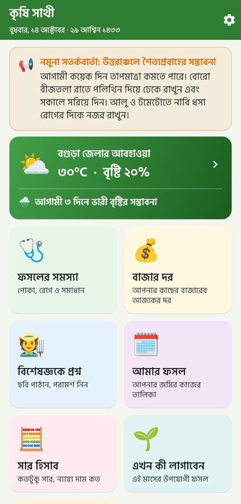
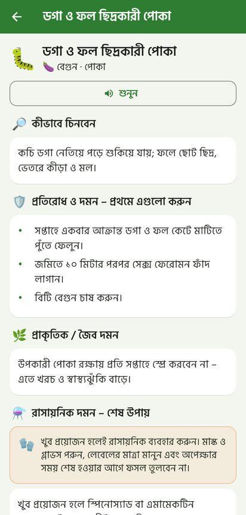
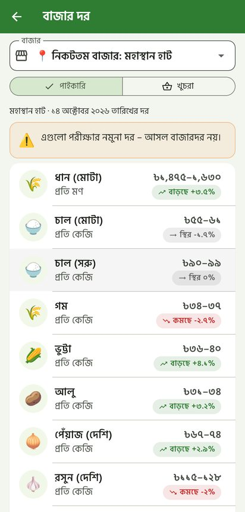
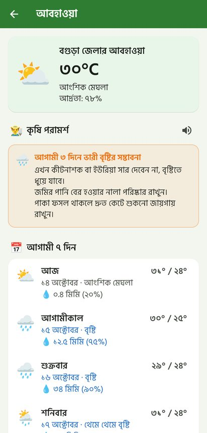
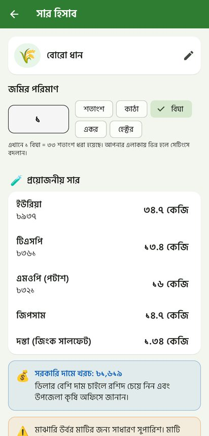
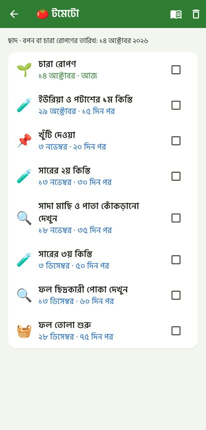
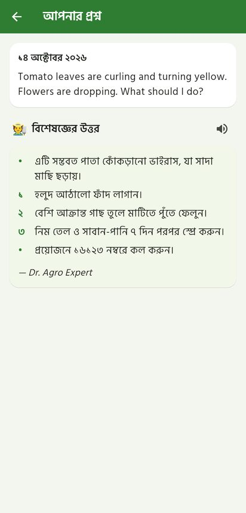
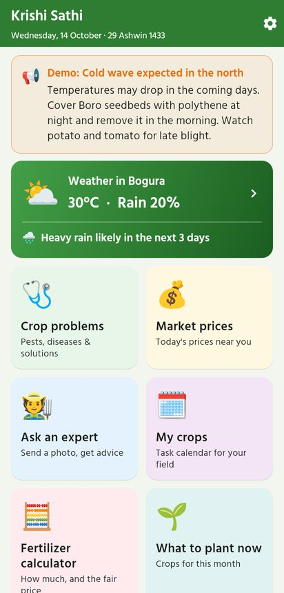

# কৃষি সাথী · Krishi Sathi

**A Bangla-first, offline-first farming companion for Bangladesh**: crop problems and IPM advice, a personal crop calendar, weather turned into farm advice, nearby market prices, a fertilizer calculator with government prices, and "ask an expert" with photos. It's built for smallholder farmers *and* rooftop or homestead gardeners.

| | |
|---|---|
| 📱 **App** | Flutter, for Android, iOS, web, Windows, macOS and Linux → [`mobile/`](mobile/) |
| 🖥️ **API + admin panel** | Laravel 12 (PHP 8.2+), MySQL/MariaDB (XAMPP) → [`backend/`](backend/) |
| 📘 **Full plan and research** | [`PROJECT_PLAN.md`](PROJECT_PLAN.md) |
| 🔌 **API reference** | [`docs/API.md`](docs/API.md) |
| 🧑‍🌾 **Admin guide** | [`docs/ADMIN_GUIDE.md`](docs/ADMIN_GUIDE.md) |
| 🚀 **Publish on Google Play** | [`docs/ANDROID_RELEASE.md`](docs/ANDROID_RELEASE.md) |

<p>




</p>
<p>




</p>

## Quick start (Windows + XAMPP)

```bash
# 1. Start MySQL in the XAMPP Control Panel, then create the database "krishi_sathi" (utf8mb4_unicode_ci) in phpMyAdmin.

# 2. Backend
cd backend
composer install
copy .env.example .env
php artisan key:generate
php artisan migrate --seed
php artisan serve                 # → http://localhost:8000/admin

# 3. App (in a second terminal)
cd mobile
flutter pub get
flutter run -d chrome             # or an Android emulator
```

Demo logins: **admin@krishisathi.test / Admin@12345**, **expert@krishisathi.test / Expert@12345**, **prices@krishisathi.test / Prices@12345**; demo farmer in the app: phone **01711111111**, PIN **12345**.

See [PROJECT_PLAN.md §11](PROJECT_PLAN.md#11-local-installation-and-configuration-xampp) for full setup, testing on a real phone, and troubleshooting.

## What's inside

* **17 crops** (rice, wheat, maize, potato, onion, mustard, lentil, jute, tomato, brinjal, chilli, cauliflower, red amaranth, bottle gourd, mango, lemon) with 111 calendar steps, 43 pests/diseases/deficiencies with IPM-first advice, and fertilizer doses, all in **Bangla and English**.
* 64 districts, 10 markets, 18 commodities, government fertilizer prices, 8 practical articles.
* Works **offline from the first launch**; a knowledge-base refresh costs about 37 KB (0 KB if unchanged).
* Read-aloud in Bangla, large-text mode, data saver, Bangla digits and the Bengali calendar date.

## Tests

```bash
cd backend && php artisan test   # 70 tests (SQLite by default; MySQL also supported)
cd mobile  && flutter test       # 25 tests (unit, repository, widget journeys)
```

A real-browser end-to-end walkthrough is in [`tools/e2e/`](tools/e2e/).

> ⚠️ Seed content is a well-sourced starting point (BRRI, BARI, BARC, DAE) but **must be reviewed by an agronomist** before public release. Seeded market prices are **demo data** and are labelled as such.
