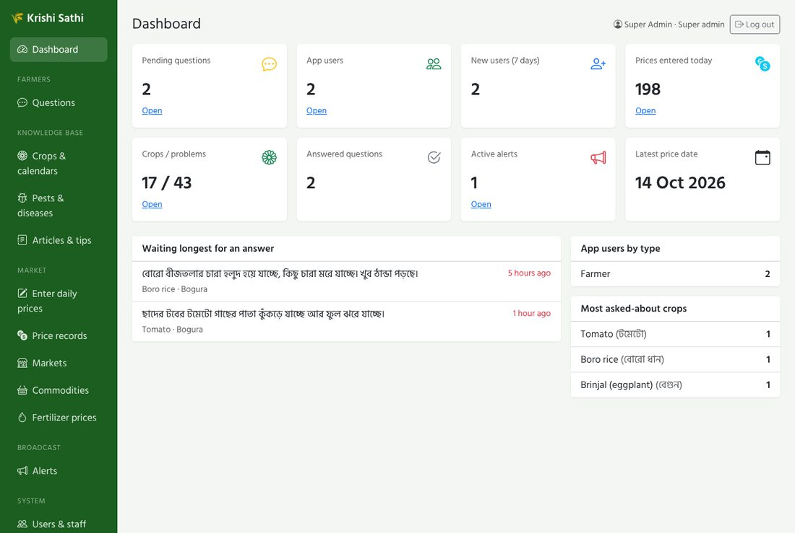
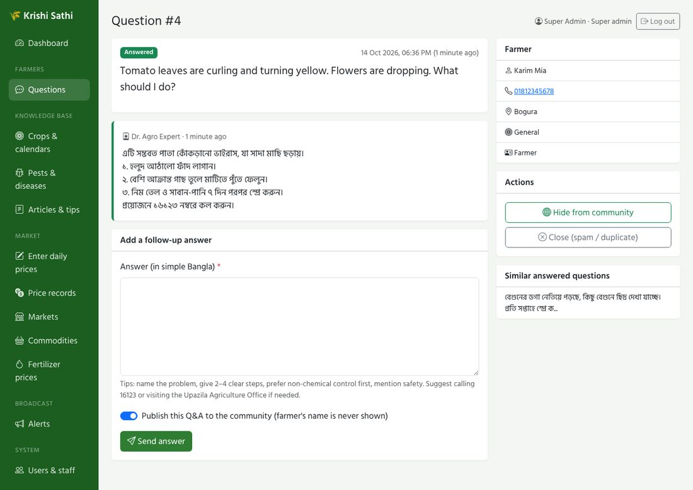
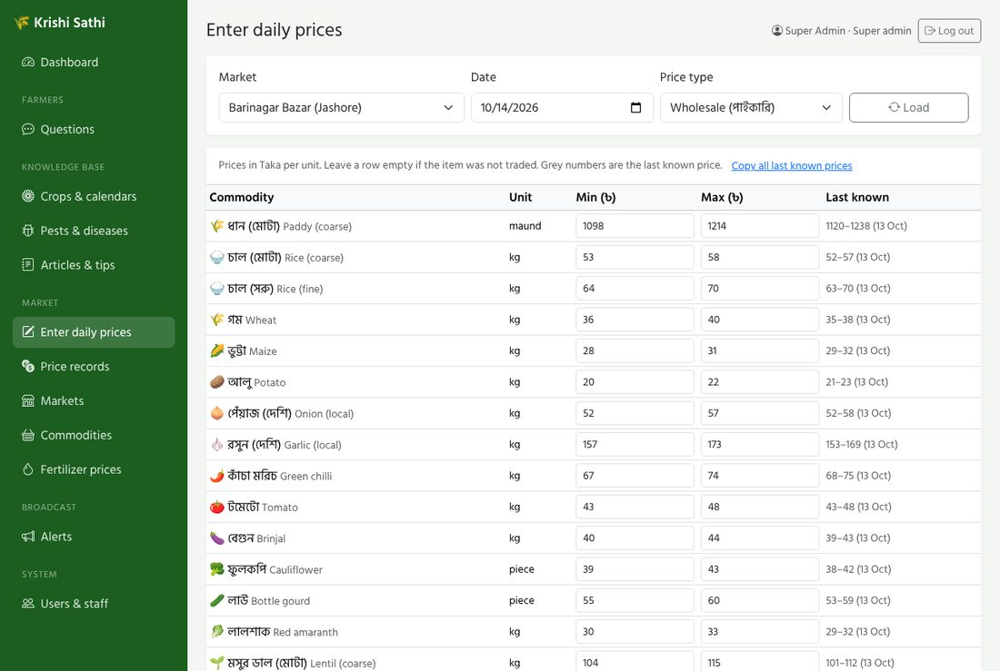
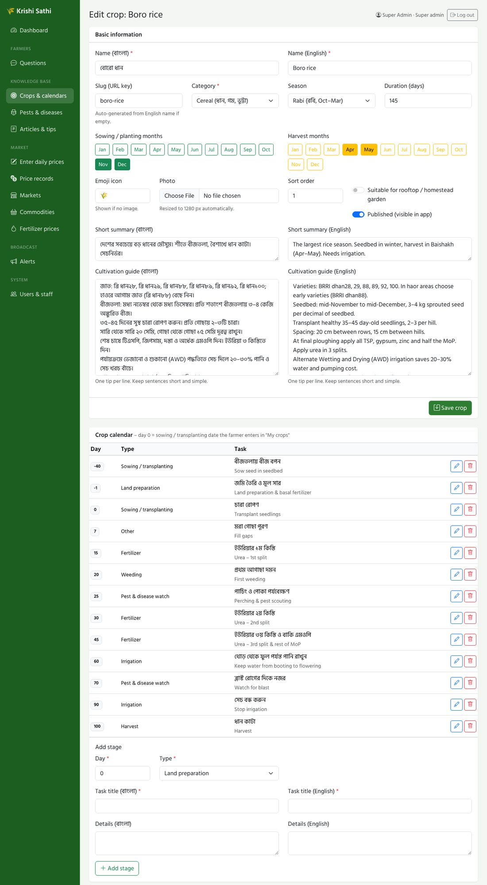

# Admin panel guide (অ্যাডমিন প্যানেল নির্দেশিকা)

Open **`/admin`** (for example http://localhost:8000/admin) and sign in with your **email or mobile number** and password.
You only see the menus your role allows.

| Role | Can do |
|---|---|
| **Super admin** | Everything, including creating other admins |
| **Admin** | Content, prices, alerts, questions, app users, experts and data-entry staff |
| **Agriculture expert** | Answer farmers' questions; edit crops, problems and articles |
| **Price data entry** | Daily prices, markets, commodities, fertilizer prices |



---

## 1. Answering farmers' questions (experts) — প্রশ্নের উত্তর

1. **Questions → Waiting.** The oldest question is first, so nobody waits too long.
2. Open a question. You see the text, the photo (click to enlarge), the crop, the district and the farmer's phone number (call if you need more details).
3. Write the answer in **simple Bangla**:
   * name the problem;
   * give 2–4 clear steps, one per line (`১.`, `২.` … lines show as a numbered list in the app);
   * put **non-chemical control first**; if a chemical is needed, name the *active ingredient* (not a brand), the label dose and the waiting period before harvest;
   * for serious cases suggest calling **16123** or visiting the Upazila Agriculture Office.
4. Tick **"Publish this Q&A to the community"** when the answer is useful for others. The farmer's name and phone are never shown, only the district.
5. **Send answer.** The farmer sees it in the app the next time they open *Ask an expert*.

Other actions: **Close (spam / duplicate)**, **Re-open**, **Hide from community**. "Similar answered questions" helps you answer consistently.



---

## 2. Entering daily market prices (data entry) — বাজারদর

**Market → Enter daily prices**

1. Choose the **market**, **date** and **price type** (wholesale / retail), then click **Load**.
2. Type the **minimum and maximum price** in Taka per unit (the unit is shown on each row: kg, maund, piece, hali …).
   * The grey numbers are the last known price. **Copy all last known prices** fills empty boxes, so you only correct what changed.
   * Leave a row empty if the item was not traded or not surveyed.
   * If there's only one price, fill just one box; it is used for both min and max.
3. Write the **source** (e.g. *DAM daily report*, *field survey*) and click **Save prices**.
   Saving the same market, date and type again **updates** the earlier entry; it doesn't create duplicates.

**Bulk import (CSV):** *Price records → Import CSV*. Download the template for a market, fill `min_price`/`max_price` in Excel, save as CSV and upload. Rows with problems (unknown market, max < min, bad date) are skipped and listed with their line numbers.

```
date,market,commodity,type,min_price,max_price,source
2026-10-14,Kawran Bazar,Potato,wholesale,20,24,DAM daily report
```

> ⚠️ The demo database contains invented prices marked **"Demo data – not real prices"**. Delete or overwrite them before real users see the app (*Price records* → filter → delete, or start production with `db:seed --class=ReferenceDataSeeder`).



**Fertilizer prices:** *Fertilizer prices → edit* when the ministry announces new farmer-level prices. The app shows them in the fertilizer calculator.

---

## 3. Crops, calendars and fertilizer (experts) — ফসল

**Knowledge base → Crops & calendars → Edit**

* **Basic information:** Bangla and English name, category, season, sowing and harvest months (click the month buttons), duration, emoji icon, photo, "suitable for rooftop", published.
* **Cultivation guide:** one tip per line. Short sentences, local variety names.
* **Crop calendar:** each step has a **day** counted from the sowing/transplanting date the farmer enters in *My crops* (day 0). Use negative days for seedbed work before transplanting (e.g. –35).
  Types (land preparation, sowing, fertilizer, irrigation, weeding, pest watch, harvest) choose the icon in the app.
* **Fertilizer recommendation:** kg **per hectare** for medium-fertility soil. The table shows the per-bigha equivalent. The app converts it to the farmer's land size and unit.



**After changing content:** apps download the new version automatically (only changes, about 40 KB). Before building a new app release, a developer runs `php artisan krishi:export-content` so new installs have it offline too.

---

## 4. Pests, diseases and deficiencies (experts) — পোকা ও রোগ

**Pests & diseases → New problem**

| Field | Advice |
|---|---|
| Crop, type, **where on the plant**, severity | Farmers find problems by tapping the plant part (leaf, stem, fruit, grain, root, whole plant). Choose carefully |
| Name | Use the name farmers use (e.g. **মাজরা পোকা**) |
| Photo | A sharp close-up of the symptom. **Use only photos you have the right to use** |
| Symptoms | What the farmer sees, one point per line |
| Prevention & cultural control | Shown **first**: IPM, perching, traps, sanitation, resistant varieties |
| Organic control | Neem, Bt, NPV, ash … |
| Chemical control | Last resort: active ingredient, when (threshold), waiting period. The app adds a safety warning automatically |

Never recommend banned pesticides. If there is no effective chemical (e.g. bacterial wilt, viruses), **say so**; it saves farmers money.

---

## 5. Alerts (admins) — সতর্কবার্তা

**Broadcast → Alerts → New alert**

* **Severity:** Info (blue), Warning (yellow), Danger (red).
* Bangla and English **title and message**: say what is happening **and what farmers should do**.
* **Whole country**, or untick it and choose districts (ticking a division selects all its districts).
* **Starts / Ends:** the alert shows at the top of the app's home screen only during this period.

Typical uses: flash flood in the haor ("harvest 80%-mature Boro now"), cyclone signals, cold waves, pest outbreaks, fertilizer distribution dates.

---

## 6. Users and staff (admins) — ব্যবহারকারী

* **Create staff:** *Users & staff → New*. Give a role, a mobile number (unique) and a password with at least 8 characters including letters and numbers.
* **Reset a farmer's PIN:** open the user → type a new 4–6 digit PIN in *Password / PIN* → Save. Tell the farmer the new PIN by phone.
* **Disable an account:** untick *Account active*. The person is signed out of the app immediately.
* Only a **super admin** can create or edit admin accounts. Nobody can change their own role or disable themselves.

---

## 7. Daily checklist

| When | Who | Task |
|---|---|---|
| Every morning | Data entry | Enter today's prices for each market |
| Twice a day | Experts | Clear the *Waiting* questions; publish good answers |
| When weather or pest news arrives | Admin | Publish or update an alert; set an end time |
| Before each season | Expert | Review calendars, problems and "what to plant" months |
| Monthly | Admin | Review users and staff; remove people who left |
